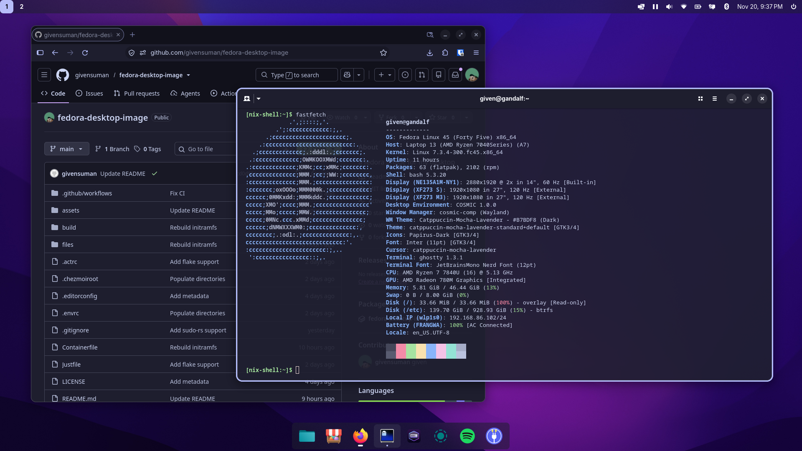

# fedora-desktop-image

a fedora image for my desktop

### Usage

This is a `bootc` image, meaning it's meant for live systems (or VMs) rather than container environments.

You can rebase to it from another `bootc` system with:

```bash
SRC=ghcr.io/givensuman/fedora-desktop-image
cosign verify --key cosign.pub "$SRC"
sudo bootc switch "$SRC"
```

```bash
chezmoi init givensuman/fedora-desktop-image \
	--apply \
	--recurse-submodules \
	--exclude=encrypted \
	--skip-secrets
```



### See Also

[givensuman/fedora-nix-image](https://github.com/givensuman/fedora-nix-image)

[givensuman/fedora-akmods-image](https://github.com/givensuman/fedora-akmods-image)

### License

[MIT](./LICENSE)
